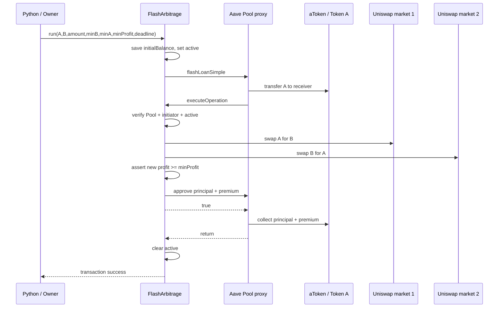

# Đọc mã theo luồng giao dịch

## 1. Deployment và các ranh giới tin cậy

`Chain` đọc RPC từ môi trường, đối chiếu chain ID với allowlist local/Sepolia, chọn tài khoản dev local hoặc ký bằng ví testnet.
Artifact Uniswap V2 lấy từ npm chính thức, giữ nguyên bytecode để hash CREATE2 của Router tương thích với Factory.
Artifact Aave lấy từ `@aave/core-v3`; bytecode Pool có placeholder library. `Chain.deploy` deploy đệ quy library phụ thuộc rồi thay đúng các vị trí `linkReferences`.
Provider tạo proxy và gọi initialize theo quy trình Aave; không deploy Pool rồi bỏ qua proxy/initializer.

`LabToken` và `LabOracle` phục vụ cấu hình lab: token có mint chỉ owner, oracle cố định. Không dùng hai thành phần này với tài sản thực.
Uniswap/Aave vẫn thực thi logic protocol thật. Các reserve/allowance/balance tồn tại trên Geth, không lưu bằng Python dict để giả kết quả.

## 2. Exact-input swap

CLI chuyển amount chuỗi decimal sang số nguyên 18 decimals, từ chối âm, zero, NaN hoặc precision quá 18 chữ số.
Router quote tất cả hop; Python tính `floor(quote*(10000-slippageBps)/10000)` làm minOut.
Sau giao dịch, Python chờ receipt, kiểm status, kiểm balance input giảm đúng amount và output tăng ít nhất minOut.
Khi không có giao dịch xen vào, output phải bằng quote; các integration test kiểm đúng điều này.

Các token lab là ERC20 thông thường, không có fee-on-transfer/rebase. Không suy ra thuật toán/CLI tương thích mọi loại token.
CLI chạy tuần tự; nonce lấy từ pending. Chưa có nonce manager cho nhiều worker đồng thời, chưa có retry/replacement policy production.

## 3. Routing

Graph dựng từ Pair được phát hiện qua main Factory, ở một block cố định.
Token0 quyết định reserve orientation. DFS không lặp vertex nên không đi qua lại một pool; vì vậy không cần cập nhật reserves nội bộ khi đánh giá một candidate.
Mỗi candidate độc lập từ snapshot ban đầu. Những pool không có reserve dương bị loại.
Mục tiêu là output token đích lớn nhất; thuật toán không đưa ra kết luận về lợi nhuận gas hay arbitrage cycle.

## 4. Flash loan và atomicity

Hợp đồng lưu balance trước vay, vì balance trong callback bao gồm cả khoản vay. Nếu không trừ initialBalance, một giao dịch lỗ có thể được che bởi tiền nạp trước.
Lợi nhuận được phát event trước khi Pool thu, nhưng nếu repayment thất bại thì event cũng rollback.
`minB`, `minA`, `deadline` được truyền xuống hai Router; `minProfit` là hàng rào cuối cùng.

Kiểm thử cố ý revert dùng `eth_call` để xác nhận lý do, sau đó gửi giao dịch có gas tường minh để bỏ qua preflight estimate và kiểm receipt `status=0`.
Snapshot reserves/balances được so trước/sau. Block number, nonce, gas balance của sender vẫn có thể đổi dù state của giao thức rollback.
