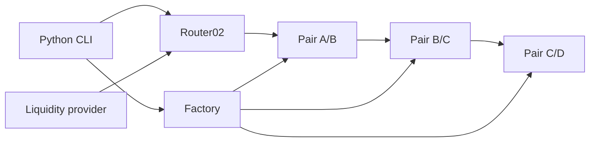

# DeFi Lab 4 — Python, Uniswap V2, Aave V3

Lab thực hành khoảng **3 giờ**, dùng blockchain **Geth local** và token tự tạo.
Backend/CLI, deploy và thuật toán route viết bằng **Python**; smart contract viết bằng **Solidity**.
Trên Windows dùng Geth `.exe` tải sẵn, **không cần Go, Linux, WSL hay Docker**. Node/npm chỉ tải artifact chính thức và biên dịch Solidity.
Không dùng mainnet hay tiền thật. CLI chỉ cho phép chain 1337, 31337 và Sepolia 11155111.

## Chạy trực tiếp trên Windows / PowerShell

Dùng **Windows 10/11 x64**, Windows PowerShell 5.1 hoặc PowerShell 7. Bạn có thể giữ dự án ở bất kỳ thư mục nào, ví dụ `D:\Projects\defi_app`; không cần `/workspace`.

### 1. Cài công cụ một lần

- Cài **Python 3.12 x64** từ [python.org](https://www.python.org/downloads/windows/), gồm Python Launcher (`py`).
- Cài **Node.js 24 x64** từ [nodejs.org](https://nodejs.org/en/download). Sau khi cài, mở lại PowerShell.
- Tải **Geth 1.14.13 Windows amd64** từ [trang tải chính thức của Geth](https://geth.ethereum.org/downloads) / danh sách các bản phát hành cũ. Giải nén ZIP, tìm `geth.exe`, ví dụ `C:\Tools\geth\geth.exe`. Không chọn bản Linux hoặc ARM64.

Kiểm tra trong PowerShell:

```powershell
py -3.12 --version
node --version
npm.cmd --version
& "C:\Tools\geth\geth.exe" version
```

Thay đường dẫn Geth bằng nơi bạn thực sự giải nén. Nếu không tìm thấy bản Geth được pin, cần lấy đúng bản 1.14.13 trước khi tiếp tục; installer kiểm tra phiên bản, không tự tải bản mới khác.
Không cần cài Go hoặc trình biên dịch C/C++: installer chỉ nhận Python wheels đã build sẵn cho Python 3.12/Windows x64.

### 2. Cài dự án trong thư mục bạn đã lưu

Mở PowerShell bình thường, không cần quyền Administrator. Thay đường dẫn ví dụ dưới đây bằng thư mục chứa `package.json` và `readme.md` của bạn:

```powershell
cd "D:\Projects\defi_app"
Set-ExecutionPolicy -Scope Process -ExecutionPolicy Bypass
.\scripts\install.ps1 -GethPath "C:\Tools\geth\geth.exe"
```

`ExecutionPolicy` ở đây chỉ áp dụng cho cửa sổ PowerShell hiện tại, không đổi chính sách toàn máy.
Script tạo `.venv`, cài dependencies theo lockfile, biên dịch Solidity, chạy unit tests và lưu đường dẫn Geth vào `.local/geth-path.txt`.
Không cần `Activate.ps1`; các lệnh dùng trực tiếp Python trong `.venv\Scripts`.
Nếu bạn đã copy `.venv` từ Linux hoặc dùng Python khác phiên bản, hãy đổi tên thư mục `.venv` cũ rồi cài lại; không dùng chung virtualenv giữa hai hệ điều hành.
Nếu installer thất bại, sửa lỗi được báo rồi chạy lại; chưa deploy khi cài đặt chưa thành công.

### 3. Terminal PowerShell thứ nhất: chạy blockchain local

```powershell
cd "D:\Projects\defi_app"
Set-ExecutionPolicy -Scope Process -ExecutionPolicy Bypass
.\scripts\start_geth.ps1
```

Giữ cửa sổ này mở. Geth dùng dữ liệu `.local/geth`, chain ID **1337**, RPC **http://127.0.0.1:8545**.
Không cần MetaMask, tài khoản faucet, RPC Sepolia hay private key. Tài khoản Geth dev tự có ETH thử nghiệm.
Nếu bạn di chuyển thư mục chứa `geth.exe`, dùng `.\scripts\start_geth.ps1 -GethPath "đường-dẫn-mới\geth.exe"` hoặc chạy lại installer với đường dẫn mới.

### 4. Terminal PowerShell thứ hai: deploy, swap và flash loan

```powershell
cd "D:\Projects\defi_app"
Set-ExecutionPolicy -Scope Process -ExecutionPolicy Bypass

# Chọn rõ local nếu trước đó bạn đã cấu hình Sepolia trong cửa sổ này.
$env:RPC_URL = "http://127.0.0.1:8545"
$env:LAB_CHAIN_ID = "1337"
Remove-Item Env:PRIVATE_KEY -ErrorAction SilentlyContinue

.\.venv\Scripts\python.exe -m defi_lab.cli status
.\.venv\Scripts\python.exe -m defi_lab.cli deploy-uniswap
.\.venv\Scripts\python.exe -m defi_lab.cli swap --path A B --amount 10
.\.venv\Scripts\python.exe -m defi_lab.cli swap --path A B C D --amount 10
.\.venv\Scripts\python.exe -m defi_lab.cli route --amount 10 --execute
.\.venv\Scripts\python.exe -m defi_lab.cli deploy-aave
.\.venv\Scripts\python.exe -m defi_lab.cli flash --amount 100 --min-profit 1
```

Chạy từng lệnh và kiểm tra thành công trước khi tiếp tục. Hai lệnh deploy chạy **một lần trên mỗi chain mới**.
Nếu dùng Git clone hoặc ZIP tải từ GitHub trên máy Windows của bạn, đó là chain mới: cần tự deploy; dữ liệu blockchain trong máy cloud không được đưa lên GitHub.
Manifest `.local/deployment-1337.json` lưu địa chỉ, chain ID và genesis. Khi mở lại dự án, khởi động Geth rồi dùng deployment đã lưu, không deploy lại.

Sau khi đã deploy cả hai giao thức, có thể chạy demo và kiểm thử bằng PowerShell:

```powershell
.\scripts\demo.ps1
.\scripts\verify_local.ps1
```

Demo làm thay đổi reserves; chênh lệch giá và lợi nhuận sẽ giảm sau nhiều lần chạy.
CLI từ chối flash loan nếu quote không đạt lợi nhuận yêu cầu, không tự thay thanh khoản để che lỗ.
Để dừng, nhấn **Ctrl+C** trong terminal Geth và chờ node lưu dữ liệu xong.

### 5. Kiểm thử riêng

```powershell
# Unit tests, không cần blockchain
.\.venv\Scripts\python.exe -m pytest tests/test_routing.py -q

# Unit + integration, cần Geth và cả hai deployment
.\scripts\verify_local.ps1
```

Script kiểm thử bật `RUN_INTEGRATION=1` trong lúc chạy và khôi phục biến đó sau khi kết thúc.
Kết quả JUnit nằm ở `.local/test-results.xml`. Một lệnh pytest thông thường không bật biến này sẽ **skip** integration tests; skip không có nghĩa là đã pass.
Suite kiểm tra Geth thật, aToken, swap trực tiếp/ba pool, quote so với reserve snapshot, trả gốc+phí flash loan,
rollback, callback/owner guard, deadline, trượt giá và giao dịch ký bằng Python.
Receipt của các giao dịch qua `Chain.send` được ghi vào `.local/transactions-<chain_id>.jsonl`.

**Trạng thái kiểm chứng:** giao thức đã chạy và qua 14 tests trên Geth/Linux. Script PowerShell và khả năng lấy wheels Windows được kiểm tra riêng;
chưa có kết quả chạy toàn bộ lab trên máy Windows thật. Xem [báo cáo kiểm chứng](docs/VALIDATION.md) để biết chính xác nền tảng và kiểm tra đã thực hiện.

### Đọc kết quả CLI

CLI chờ receipt `status=1` và đối chiếu số dư; một transaction hash không đủ chứng minh thành công.
JSON ghi amount/output/fee/profit bằng **đơn vị nhỏ nhất**, 18 decimals: `1000000000000000000` là 1 token.
`--amount 10` nghĩa là 10 token. `--min-profit` tính theo A, **chưa trừ gas ETH**.

## Kiến trúc Uniswap V2



- **Factory** tạo Pair bằng CREATE2, quản lý `getPair`, `allPairs`; mỗi cặp token chỉ có một Pair trong một Factory.
- **Pair** giữ hai ERC20, reserves và LP token. `mint/burn` phục vụ thanh khoản; `swap` kiểm tra invariant sau khi nhận input.
- **Router02** là lớp tiện ích không giữ tài sản lâu dài: chuyển token vào Pair đầu, tính lượng output và nối các Pair.
- **LP token** biểu diễn tỷ lệ sở hữu thanh khoản, không phải token A/B. LP thu phí nhưng chịu impermanent loss.
- **WETH9** được deploy để Router có cấu hình đầy đủ; demo chỉ swap ERC20/ERC20, không wrap ETH.
- **Core** chứa Factory/Pair tối thiểu; **Periphery** chứa Router, tính path, deadline, min output và giao tiếp người dùng.

Với input `dx`, reserves input `x`, output `y`, phí 0,3%:

```text
amountInWithFee = dx * 997
amountOut = floor(amountInWithFee * y / (x * 1000 + amountInWithFee))
```

Pair dùng số nguyên, không dùng số thực. Phí nằm lại trong pool, nên tích reserves sau swap thường tăng.
`x*y=k` là mô hình trước phí; invariant thực kiểm tra adjusted balances.
Reserves được sắp theo địa chỉ `token0/token1`, không theo tên A/B; Python đọc `token0` để định hướng đúng.

Swap token/token: approve Router → Router `transferFrom` A → Pair A/B → B về ví.
Swap A→B→C→D: Router chuyển output B trực tiếp tới Pair B/C, rồi C tới Pair C/D; chỉ D cuối cùng về ví.
Ba swap nằm trong **một transaction**, không phải ba lệnh Python độc lập. Một hop lỗi thì toàn bộ revert.
`amountOutMin` giới hạn slippage; deadline giới hạn thời gian giao dịch có thể được chấp nhận.

Đồ thị demo:

| Pool | Thanh khoản ban đầu |
|---|---:|
| Main A/B | 100.000 A : 100.000 B |
| Main B/C | 100.000 B : 100.000 C |
| Main C/D | 100.000 C : 100.000 D |
| Main A/D | 100.000 A : 70.000 D |
| Market thứ hai A/B | 120.000 A : 100.000 B |

Hai market là hai **Uniswap Factory/Router thật**, giúp tạo chênh lệch giá dễ quan sát.
Không sửa storage của Pair, không mock kết quả giao dịch.

## Tìm swap route tốt nhất

`defi_lab/routing.py` đọc toàn bộ Pair của **main Factory** tại **cùng một block**.
Mỗi cạnh có reserves theo đúng chiều. DFS liệt kê simple path không lặp token/Pair, tối đa mặc định 3 hop (cho phép 1–6).
Mỗi bước truyền output nguyên của pool trước vào công thức pool sau. Chọn output cuối lớn nhất; hòa thì chọn ít hop hơn.

Đây là nghiệm tối ưu **trong đồ thị, hop bound và tập simple path được xét**, cho một lượng input cụ thể.
Không khẳng định tối ưu toàn thị trường. Không chia lệnh qua nhiều route, không gộp nhiều DEX, chưa tính gas/MEV.
Độ phức tạp xấp xỉ `O(b^h)` với b là số cạnh nhánh và h là số hop; phù hợp lab bốn token, không dùng nguyên trạng cho hàng nghìn pool.
Không dùng Dijkstra với trọng số spot price cố định vì giá thực thi phụ thuộc amount và price impact.
Reserves thay đổi sau quote; CLI quote lại trước khi gửi, vẫn cần `minOut` vì quote mới không khóa trạng thái chain.

## Aave và flash loan

Deploy **Aave V3 core 1.19.3** từ artifact chính thức:
PoolAddressesProvider → ACLManager → các library link vào Pool → Pool implementation + proxy →
PoolConfigurator implementation + proxy → DataProvider → AToken/StableDebtToken/VariableDebtToken implementation →
interest rate strategy → reserve A → supply 1.000.000 A → FlashArbitrage.

Đây là **market thử nghiệm tối thiểu thật**, không phải mock Aave. Reserve A bật flash loan, premium total đặt **5 bps = 0,05%**.
Oracle `LabOracle` cố định 1 USD để phục vụ môi trường thử nghiệm; **không dùng để định giá tài sản thực**.
Lab không cấu hình collateral/borrow market đầy đủ và không kiểm thử vay thường, liquidation hay governance.
StableDebtToken xuất hiện theo cấu trúc bản Aave V3 được pin; không suy ra rằng mọi thị trường Aave hiện tại đều cho vay stable rate.

Luồng `FlashArbitrage.run`:

1. Owner yêu cầu Aave `flashLoanSimple` vay A.
2. Aave chuyển A từ aToken và gọi `executeOperation` trong cùng transaction.
3. Receiver kiểm tra `msg.sender == pool`, `initiator == address(this)` và trạng thái đang chạy.
4. Swap A→B trên market chính; B→A trên market thứ hai.
5. Yêu cầu `endingBalance >= startingBalance + principal + premium + minProfit`.
6. Approve cho Aave thu gốc+phí; Aave thu tiền sau callback. Phần tăng số dư còn lại là profit của receiver.

Không cần nạp sẵn phí để che lỗ. Số dư có sẵn **không được tính là lợi nhuận mới**.
Chênh lệch giá được cố ý tạo khi seed thanh khoản; đây là minh họa cơ chế atomic arbitrage, không phải bot kiếm tiền ngoài thị trường.
Nếu không đủ trả hoặc không đạt lợi nhuận, mọi swap và khoản vay revert; người gửi vẫn tốn gas trên mạng có phí.
`withdraw(asset)` chỉ owner gọi để lấy số dư của receiver. Tài khoản deploy lab là owner/admin; đây không phải mô hình quản trị production.

## Sepolia — tùy chọn, không cần cho lab local

Bạn có thể bỏ qua mục này khi dùng Geth local. Sepolia **chưa được kiểm chứng bằng giao dịch thực tế** trong dự án.
Để thử, cần RPC Sepolia HTTPS, ví chỉ testnet và Sepolia ETH trả gas. Đặt biến trong PowerShell riêng:

```powershell
$env:RPC_URL = "https://YOUR_SEPOLIA_RPC"
$env:LAB_CHAIN_ID = "11155111"
```

Nhập private key qua biến môi trường riêng trên máy bạn; không đưa khóa vào README, chat hoặc GitHub.
CLI không tự đọc file `.env`; cũng không dùng `source .env` trong PowerShell.
Sau đó dùng `.\.venv\Scripts\python.exe -m defi_lab.cli status`, kiểm tra đúng chain/số dư rồi mới deploy.
CLI ký bằng `PRIVATE_KEY` khi chạy Sepolia; local dùng tài khoản dev nên không cần biến này.

Các lệnh deploy tạo market riêng của lab, không dùng địa chỉ mainnet. Deploy Aave gồm nhiều transaction và cần test ETH đáng kể.
Nếu hết gas giữa chừng, những contract đã mine vẫn tồn tại. Script chưa resume từng bước; bổ sung gas rồi chạy lại có thể tạo market mới.
Không chạy suite tích hợp local lên Sepolia. Để quay lại local, đặt RPC/chain ID 1337 và bỏ biến PRIVATE_KEY như hướng dẫn trên.

## Lộ trình 3 giờ

| Phút | Nội dung | Kết quả cần giải thích |
|---|---|---|
| 0–25 | Đọc kiến trúc, công thức, bật Geth | Factory/Pair/Router, token0, reserves |
| 25–60 | Deploy Uniswap, swap A/B | approve, allowance, receipt, balance delta |
| 60–90 | Swap A/B/C/D và route | atomic multi-hop, phí từng hop, price impact |
| 90–125 | Deploy Aave, supply | Provider/proxy/ACL, aToken và reserve |
| 125–160 | Flash loan và failure tests | callback, repayment, premium, rollback |
| 160–180 | Demo và vấn đáp | Giải thích code, giới hạn, bằng chứng test |

Đọc [câu hỏi vấn đáp kèm giải thích](docs/VIVA.md) và [luồng kiến trúc chi tiết](docs/ARCHITECTURE.md). Thời gian trên giả định toolchain đã được cài trước buổi học.

## Tệp chính và xử lý lỗi

- `defi_lab/chain.py`: RPC, hạn chế chain, ký/gửi giao dịch, link library, manifest.
- `defi_lab/deploy.py`: deploy/seed Uniswap và market Aave.
- `defi_lab/cli.py`: swap, route, flash loan, kiểm tra balance/event.
- `contracts/Lab.sol`: token, oracle lab, flash receiver.
- `scripts/start_geth.ps1`, `scripts/demo.ps1`: khởi động node và demo.
- `.local/`: chain data, manifest, báo cáo test; không commit.

`py` không tồn tại: cài Python Launcher cùng Python 3.12, mở lại PowerShell.
`npm.ps1 cannot be loaded`: installer dùng `npm.cmd`; nếu chạy tay hãy dùng `npm.cmd` hoặc áp dụng ExecutionPolicy theo hướng dẫn.
`Geth not found`: kiểm tra đường dẫn `.exe`, truyền `-GethPath` đúng.
`Connection refused`: khởi động Geth, xem log terminal 1. `Already exists`: dùng lại deployment hiện có.
`Missing bytecode`: chain đã bị reset; manifest cũ không còn hợp lệ.
Muốn bắt đầu lại: dừng đúng Geth của lab, đổi tên `.local/geth` và `.local/deployment-1337.json` sang bản lưu bằng File Explorer rồi chạy/deploy lại. Giữ các file khác trong `.local`, gồm cấu hình đường dẫn Geth.
Không xóa chain data khi Geth đang chạy.
`unprofitable`: reserves đã đổi hoặc minProfit quá cao; đọc quote, dùng chain mới nếu cần demo số liệu ban đầu.
`403` khi cài: kiểm tra domain bị chặn; không tắt TLS, checksum hoặc thay checksum mong đợi.
RPC chỉ mở `127.0.0.1`; tài khoản dev tự mở khóa chỉ phù hợp chain disposable local.

Nguồn: [Uniswap V2 docs](https://docs.uniswap.org/contracts/v2/overview),
[Uniswap V2 core](https://github.com/Uniswap/v2-core), [periphery](https://github.com/Uniswap/v2-periphery),
[Aave V3 core](https://github.com/aave/aave-v3-core), [Geth dev mode](https://geth.ethereum.org/docs/developers/dapp-developer/dev-mode).
Phiên bản được pin cho tính tái lập của bài học; không coi đây là khuyến nghị triển khai production.
