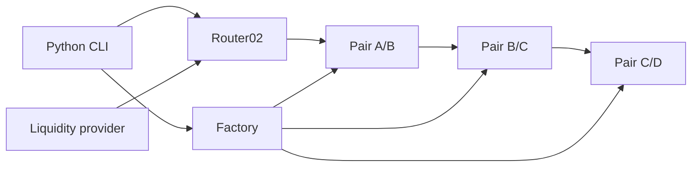

# DeFi Lab 4 — Python, Uniswap V2, Aave V3

Lab thực hành khoảng **3 giờ**, dùng blockchain **Geth local** và token tự tạo.
Backend/CLI, deploy và thuật toán route viết bằng **Python**; smart contract viết bằng **Solidity**.
Go chỉ dùng để build client Geth nếu máy chưa có binary. Node/npm chỉ tải artifact chính thức và biên dịch Solidity.
Không dùng mainnet hay tiền thật. CLI chỉ cho phép chain 1337, 31337 và Sepolia 11155111.

## Chạy nhanh

Yêu cầu Linux x86_64, Python 3.12, Node 20+ (đã kiểm thử Node 24), curl, tar, GCC/make để build Geth.
Trong môi trường này thư mục dự án là `/workspace/defi_app`.

```bash
cd /workspace/defi_app
bash scripts/install.sh
```

Lần đầu build Geth có thể mất vài phút, nên cài trước giờ học. Các lần sau dùng binary/cache đã cài.
Script giữ TLS, SHA256 của Go và Go checksum database; không bỏ xác minh để vượt lỗi mạng.
Nếu đã có Geth 1.14.13, có thể bỏ bước build và đặt `GETH_BIN=/path/to/geth` khi chạy node.

Terminal 1 — giữ tiến trình Geth chạy:

```bash
bash scripts/start_geth.sh
```

Terminal 2:

```bash
cd /workspace/defi_app
.venv/bin/python -m defi_lab.cli status
.venv/bin/python -m defi_lab.cli deploy-uniswap
.venv/bin/python -m defi_lab.cli swap --path A B --amount 10
.venv/bin/python -m defi_lab.cli swap --path A B C D --amount 10
.venv/bin/python -m defi_lab.cli route --amount 10
.venv/bin/python -m defi_lab.cli route --amount 10 --execute
.venv/bin/python -m defi_lab.cli deploy-aave
.venv/bin/python -m defi_lab.cli flash --amount 100 --min-profit 1
```

Hai lệnh deploy chạy **một lần trên mỗi chain mới**. Manifest `.local/deployment-1337.json` lưu địa chỉ, chain ID và genesis.
Các lệnh CLI tự kiểm tra receipt `status`, chain ID và bytecode; không coi transaction hash là bằng chứng thành công.
Số dư token/quote/fee/profit trong JSON là **đơn vị nhỏ nhất** (18 decimals); `--amount 10` là 10 token.
`--min-profit` tính theo token A, **chưa trừ gas ETH**.

Demo sau khi deploy cả hai giao thức:

```bash
bash scripts/demo.sh
```

Demo làm thay đổi reserves. Có thể chạy lại một số lần; chênh lệch giá và lợi nhuận sẽ giảm.
Không tự tạo lại thanh khoản để che một lần arbitrage không còn lãi: CLI sẽ từ chối nếu quote hiện tại không đạt yêu cầu.

## Kiểm thử

```bash
# Kiểm thử thuật toán, không cần blockchain
.venv/bin/python -m pytest tests/test_routing.py -q

# Giao dịch thật trên chain local đã deploy cả Uniswap và Aave
bash scripts/verify_local.sh
```

Suite tích hợp kiểm tra Geth thật, bytecode, aToken sau supply, swap trực tiếp và ba pool, quote so với reserve snapshot,
lợi nhuận flash loan, Aave nhận lại gốc+phí, rollback reserves/số dư, callback trái phép, trượt giá và deadline.
Các giao dịch cố ý thất bại vẫn được gửi và kiểm tra receipt revert; `eth_call` bổ sung lý do lỗi.
Không đặt `RUN_INTEGRATION=1` thì các kiểm thử tích hợp **bị skip**, không phải đã pass.
Suite tích hợp chỉ dùng local; không tự gửi loạt test lên Sepolia.
Receipt của các giao dịch qua `Chain.send` được ghi vào `.local/transactions-<chain_id>.jsonl`, gồm hash, block, status và gas used; không chứa private key.
Xem [báo cáo kiểm chứng](docs/VALIDATION.md) để phân biệt kết quả đã chạy và chưa chạy.

## Kiến trúc Uniswap V2



- **Factory** tạo Pair bằng CREATE2, quản lý `getPair`, `allPairs`; mỗi cặp token chỉ có một Pair trong một Factory.
- **Pair** giữ hai ERC20, reserves và LP token. `mint/burn` phục vụ thanh khoản; `swap` kiểm tra invariant sau khi nhận input.
- **Router02** là lớp tiện ích không giữ tài sản lâu dài: chuyển token vào Pair đầu, tính lượng output và nối các Pair.
- **LP token** biểu diễn tỷ lệ sở hữu thanh khoản, không phải token A/B. LP thu phí nhưng chịu impermanent loss.
- **WETH9** được deploy để Router có cấu hình đầy đủ; demo chỉ swap ERC20/ERC20, không wrap ETH.
- **Core** chứa Factory/Pair tối thiểu; **Periphery** chứa Router, tính path, deadline, min output và giao tiếp người dùng.

Với input `dx`, reserves input `x`, output `y`, phí 0,3%:

```text
amountInWithFee = dx * 997
amountOut = floor(amountInWithFee * y / (x * 1000 + amountInWithFee))
```

Pair dùng số nguyên, không dùng số thực. Phí nằm lại trong pool, nên tích reserves sau swap thường tăng.
`x*y=k` là mô hình trước phí; invariant thực kiểm tra adjusted balances.
Reserves được sắp theo địa chỉ `token0/token1`, không theo tên A/B; Python đọc `token0` để định hướng đúng.

Swap token/token: approve Router → Router `transferFrom` A → Pair A/B → B về ví.
Swap A→B→C→D: Router chuyển output B trực tiếp tới Pair B/C, rồi C tới Pair C/D; chỉ D cuối cùng về ví.
Ba swap nằm trong **một transaction**, không phải ba lệnh Python độc lập. Một hop lỗi thì toàn bộ revert.
`amountOutMin` giới hạn slippage; deadline giới hạn thời gian giao dịch có thể được chấp nhận.

Đồ thị demo:

| Pool | Thanh khoản ban đầu |
|---|---:|
| Main A/B | 100.000 A : 100.000 B |
| Main B/C | 100.000 B : 100.000 C |
| Main C/D | 100.000 C : 100.000 D |
| Main A/D | 100.000 A : 70.000 D |
| Market thứ hai A/B | 120.000 A : 100.000 B |

Hai market là hai **Uniswap Factory/Router thật**, giúp tạo chênh lệch giá dễ quan sát.
Không sửa storage của Pair, không mock kết quả giao dịch.

## Tìm swap route tốt nhất

`defi_lab/routing.py` đọc toàn bộ Pair của **main Factory** tại **cùng một block**.
Mỗi cạnh có reserves theo đúng chiều. DFS liệt kê simple path không lặp token/Pair, tối đa mặc định 3 hop (cho phép 1–6).
Mỗi bước truyền output nguyên của pool trước vào công thức pool sau. Chọn output cuối lớn nhất; hòa thì chọn ít hop hơn.

Đây là nghiệm tối ưu **trong đồ thị, hop bound và tập simple path được xét**, cho một lượng input cụ thể.
Không khẳng định tối ưu toàn thị trường. Không chia lệnh qua nhiều route, không gộp nhiều DEX, chưa tính gas/MEV.
Độ phức tạp xấp xỉ `O(b^h)` với b là số cạnh nhánh và h là số hop; phù hợp lab bốn token, không dùng nguyên trạng cho hàng nghìn pool.
Không dùng Dijkstra với trọng số spot price cố định vì giá thực thi phụ thuộc amount và price impact.
Reserves thay đổi sau quote; CLI quote lại trước khi gửi, vẫn cần `minOut` vì quote mới không khóa trạng thái chain.

## Aave và flash loan

Deploy **Aave V3 core 1.19.3** từ artifact chính thức:
PoolAddressesProvider → ACLManager → các library link vào Pool → Pool implementation + proxy →
PoolConfigurator implementation + proxy → DataProvider → AToken/StableDebtToken/VariableDebtToken implementation →
interest rate strategy → reserve A → supply 1.000.000 A → FlashArbitrage.

Đây là **market thử nghiệm tối thiểu thật**, không phải mock Aave. Reserve A bật flash loan, premium total đặt **5 bps = 0,05%**.
Oracle `LabOracle` cố định 1 USD để phục vụ môi trường thử nghiệm; **không dùng để định giá tài sản thực**.
Lab không cấu hình collateral/borrow market đầy đủ và không kiểm thử vay thường, liquidation hay governance.
StableDebtToken xuất hiện theo cấu trúc bản Aave V3 được pin; không suy ra rằng mọi thị trường Aave hiện tại đều cho vay stable rate.

Luồng `FlashArbitrage.run`:

1. Owner yêu cầu Aave `flashLoanSimple` vay A.
2. Aave chuyển A từ aToken và gọi `executeOperation` trong cùng transaction.
3. Receiver kiểm tra `msg.sender == pool`, `initiator == address(this)` và trạng thái đang chạy.
4. Swap A→B trên market chính; B→A trên market thứ hai.
5. Yêu cầu `endingBalance >= startingBalance + principal + premium + minProfit`.
6. Approve cho Aave thu gốc+phí; Aave thu tiền sau callback. Phần tăng số dư còn lại là profit của receiver.

Không cần nạp sẵn phí để che lỗ. Số dư có sẵn **không được tính là lợi nhuận mới**.
Chênh lệch giá được cố ý tạo khi seed thanh khoản; đây là minh họa cơ chế atomic arbitrage, không phải bot kiếm tiền ngoài thị trường.
Nếu không đủ trả hoặc không đạt lợi nhuận, mọi swap và khoản vay revert; người gửi vẫn tốn gas trên mạng có phí.
`withdraw(asset)` chỉ owner gọi để lấy số dư của receiver. Tài khoản deploy lab là owner/admin; đây không phải mô hình quản trị production.

## Sepolia — tùy chọn, cần RPC và test ETH

Đường chạy testnet sử dụng cùng Python deploy/CLI; trạng thái kiểm chứng nằm trong `docs/VALIDATION.md`.
Không cần Go/Geth nếu dùng RPC Sepolia do nhà cung cấp vận hành.

1. Tạo ví **chỉ dành cho testnet**, nhận Sepolia ETH từ faucet, lấy RPC Sepolia HTTPS.
2. Đặt biến qua terminal riêng hoặc file `.env` được gitignore; không commit hoặc gửi private key trong chat.
   CLI không tự đọc `.env`; có thể `set -a; source .env; set +a` nếu tự tạo file.
3. Export `RPC_URL`, `LAB_CHAIN_ID=11155111`, `PRIVATE_KEY` (xem `.env.example`).
4. Chạy `status`; kiểm tra đúng chain 11155111 và số dư gas.
5. Chạy `deploy-uniswap`, demo swap/route; sau đó `deploy-aave` và `flash`.

Các lệnh deploy tạo market của riêng lab trên Sepolia, **không dùng địa chỉ Aave/Uniswap mainnet**.
Deploy toàn bộ Aave gồm nhiều contract/transaction và cần đáng kể test ETH; có thể hoàn thành mục 1–4 trước khi triển khai Aave.
Nếu hết gas giữa deploy, transaction đã mine không bị rollback; manifest Aave chỉ ghi khi toàn bộ bước thành công.
Sau khi bổ sung test ETH có thể chạy lại `deploy-aave` để triển khai một market mới; contract dở dang vẫn còn trên chain.
Đây là hạn chế phục hồi deploy, không phải tính năng resume từng transaction.
RPC testnet cần được cho phép trong chính sách mạng của môi trường; chỉ thêm hostname cần dùng.

## Lộ trình 3 giờ

| Phút | Nội dung | Kết quả cần giải thích |
|---|---|---|
| 0–25 | Đọc kiến trúc, công thức, bật Geth | Factory/Pair/Router, token0, reserves |
| 25–60 | Deploy Uniswap, swap A/B | approve, allowance, receipt, balance delta |
| 60–90 | Swap A/B/C/D và route | atomic multi-hop, phí từng hop, price impact |
| 90–125 | Deploy Aave, supply | Provider/proxy/ACL, aToken và reserve |
| 125–160 | Flash loan và failure tests | callback, repayment, premium, rollback |
| 160–180 | Demo và vấn đáp | Giải thích code, giới hạn, bằng chứng test |

Đọc [câu hỏi vấn đáp kèm giải thích](docs/VIVA.md) và [luồng kiến trúc chi tiết](docs/ARCHITECTURE.md). Thời gian trên giả định toolchain đã được cài trước buổi học.

## Tệp chính và xử lý lỗi

- `defi_lab/chain.py`: RPC, hạn chế chain, ký/gửi giao dịch, link library, manifest.
- `defi_lab/deploy.py`: deploy/seed Uniswap và market Aave.
- `defi_lab/cli.py`: swap, route, flash loan, kiểm tra balance/event.
- `contracts/Lab.sol`: token, oracle lab, flash receiver.
- `scripts/start_geth.sh`, `scripts/demo.sh`: khởi động node và demo.
- `.local/`: chain data, manifest, báo cáo test; không commit.

`Connection refused`: khởi động Geth, xem log terminal 1. `Already exists`: dùng lại deployment hiện có.
`Missing bytecode`: chain đã bị reset; manifest cũ không còn hợp lệ.
Muốn bắt đầu lại: dừng đúng Geth của lab, đổi tên `.local/geth` và `.local/deployment-1337.json` sang bản lưu rồi chạy/deploy lại.
Không xóa chain data khi Geth đang chạy.
`unprofitable`: reserves đã đổi hoặc minProfit quá cao; đọc quote, dùng chain mới nếu cần demo số liệu ban đầu.
`403` khi cài: kiểm tra domain bị chặn; không tắt TLS, checksum hoặc thay checksum mong đợi.
RPC chỉ mở `127.0.0.1`; tài khoản dev tự mở khóa chỉ phù hợp chain disposable local.

Nguồn: [Uniswap V2 docs](https://docs.uniswap.org/contracts/v2/overview),
[Uniswap V2 core](https://github.com/Uniswap/v2-core), [periphery](https://github.com/Uniswap/v2-periphery),
[Aave V3 core](https://github.com/aave/aave-v3-core), [Geth dev mode](https://geth.ethereum.org/docs/developers/dapp-developer/dev-mode).
Phiên bản được pin cho tính tái lập của bài học; không coi đây là khuyến nghị triển khai production.
